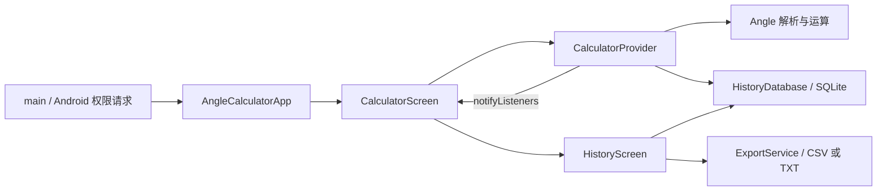

# 项目入门指南：角度计算器

## 项目概述

这是供测绘人员离线使用的 Flutter Android 应用，提供度分秒四则运算、十进制度转换、SQLite 历史记录和 CSV/TXT 导出。当前配置版本为 `1.0.4+5`，应用包名为 `com.surveying.angle_calculator`。

阅读顺序：[项目指令](../AGENTS.md) → 本指南 → [项目概览](../项目概览.md)。开发演进保留在项目概览和[更新说明](../更新说明.md)，本次实测与待修问题见[初始化核查](./初始化核查.md)。

## 技术栈

| 层级 | 技术 | 当前依据 |
|------|------|----------|
| 语言与界面 | Dart、Flutter、Material 3 | 本机 Flutter 3.27.4 / Dart 3.6.2；声明 Dart `>=3.0.0 <4.0.0` |
| 依赖解析约束 | Dart / Flutter SDK | 锁文件要求 Dart `>=3.6.0 <4.0.0`、Flutter `>=3.27.0` |
| 状态管理 | Provider / ChangeNotifier | 锁定 provider 6.1.5+1 |
| 本地持久化 | sqflite / SQLite | 锁定 sqflite 2.4.1，数据库 schema 版本 1 |
| 文件与时间 | path_provider、path、intl | 应用专属外部目录、CSV/TXT、时间戳格式化 |
| 权限 | permission_handler | 启动时请求；导出服务没有权限检查 |
| Android 构建 | AGP 8.3.0、Gradle 8.4、Kotlin 1.9.0 | Java/Kotlin 编译目标 1.8；本机 JDK 21.0.12 |
| 测试与检查 | flutter_test、flutter_lints | 配置位于 ../analysis_options.yaml |

Android 配置：minSdk 21、targetSdk/compileSdk 35、NDK 25.1.8937393。当前只有 Android 平台目录，没有后端、远程 API、ORM 或 CI 配置。Release 构建当前使用 debug 签名。

## 架构与数据流



一次计算：按钮经 `_handleButtonPress()` 进入 Provider；`setOperator()` 保存第一操作数，`calculate()` 解析第二操作数并调用 `Angle` 运算；尝试写入历史后更新当前值和两行显示，最后通知界面刷新。乘除第二操作数必须是纯数值，加减第二操作数按角度解析。

保存历史失败时只记录 `debugPrint`，计算结果仍会显示；计算或解析失败通过显示文本提示。历史页读取、删除数据库记录，再选择导出格式，写入应用专属外部目录下的 `Exports/`；不存在可用目录时导出报错。

历史复用目前尚未接通：历史卡片返回的是表达式，而计算器页没有接收路由返回值；Provider 中虽有 `loadFromHistory(result)`，当前界面没有调用它。

## 目录职责与修改位置

| 任务 | 位置与职责 |
|------|------------|
| 应用启动、主题、路由、启动权限 | `../lib/main.dart` |
| 角度解析、格式、精度与四则运算 | `../lib/models/angle.dart` |
| 历史记录对象与数据库映射 | `../lib/models/history_entry.dart` |
| 输入、运算、转换和结果复用状态 | `../lib/providers/calculator_provider.dart` |
| 按钮、显示区域与历史路由入口 | `../lib/screens/calculator_screen.dart` |
| 历史列表、删除和导出交互 | `../lib/screens/history_screen.dart` |
| 数据库建表、读写和删除 | `../lib/services/history_database.dart` |
| 导出路径、文件格式和命名 | `../lib/services/export_service.dart` |
| Android 包名、SDK、编译与签名 | `../android/app/build.gradle`、`../android/settings.gradle` |
| 依赖、SDK 约束和应用版本 | `../pubspec.yaml`、`../pubspec.lock` |
| 模型自动化测试 | `../test/angle_test.dart` |
| 构建操作和现有 BAT 说明 | [构建说明](../构建说明.md) |
| 历史修复设计、待填写的人工测试清单 | `./superpowers/specs/` |
| 本机索引、缓存、产物与 IDE 设置 | `../.codegraph/`、`../.dart_tool/`、`../build/`、`../.idea/` |

## 运行与验证

以下命令从项目根目录在 PowerShell 执行。每次新终端或新脚本先设置 UTF-8 和错误处理：

```powershell
$ErrorActionPreference = 'Stop'
$OutputEncoding = [Console]::InputEncoding = [Console]::OutputEncoding = New-Object System.Text.UTF8Encoding
$PSDefaultParameterValues['*:Encoding'] = 'UTF8'
flutter --version
if ($LASTEXITCODE -ne 0) { throw 'Flutter 版本检查失败' }
```

| 常见任务 | 根目录命令 | 说明 |
|----------|------------|------|
| 获取锁定依赖 | `flutter pub get` | 当前任务未重新获取或升级依赖 |
| 启动应用 | `flutter run` | 需要 Android 设备或模拟器；本次未运行 |
| 自动化测试 | `flutter test --no-pub --reporter expanded` | 已实测；已有依赖缓存时使用 |
| 静态分析 | `flutter analyze --no-pub` | 已实测；当前返回 7 条 info 和非零退出码 |
| Release APK | `flutter build apk --release` | 输出 `../build/app/outputs/flutter-apk/app-release.apk`；本次未构建 |
| 索引状态 | `codegraph status --json .` | 检查完整性与待同步变更 |
| 源码变更后同步 | `codegraph sync .` | 已实测 |
| 完整重建索引 | `codegraph index .` | CLI 提供；本次使用 init 建立初始索引 |

外部命令执行后立即检查 `$LASTEXITCODE`，非零时抛错。现有 BAT 交互、版本更新和清理行为详见构建说明；其中完整脚本的 analyze 失败只警告，仍继续构建，不能用脚本成功来证明检查通过。

## 项目约定

- Dart 文件用 `snake_case.dart`，类用 `PascalCase`，方法和字段用 `lowerCamelCase`；私有成员以 `_` 开头。
- 使用相对路径导入业务模块、`package:` 导入依赖；状态集中在 Provider，数据库和导出留在服务层。
- `_currentValue` 是当前数值，`_inputBuffer` 是正在输入的文本；显示字符串不能代替权威数值。
- 新增测试沿用 `test/*_test.dart` 和 `flutter_test`。当前 9 个模型测试加 1 个占位 widget 测试，不能代表界面和 Android 插件集成已验证。
- 项目使用 Git，主分支为 `main`，远端 `origin` 指向[公开仓库](https://github.com/lhbacxc/angle-calculation)。初始历史尚不足以确定合并流程。
- 文档使用中文、UTF-8 和相对路径；新增开发事实优先更新对应文档，执行规则集中在 `../AGENTS.md`。
- 修改精度或历史复用前先读初始化核查：现有实现仍有整数秒舍入和路由接线缺失，历史设计文档不能当作验收结果。

## CodeGraph 使用

初始索引已通过 CLI 创建，并通过 `codegraph_explore` MCP 查询验证。查询时传项目根目录为 `projectPath`，例如查询 `CalculatorProvider calculate Angle normalize`，可获得源码与调用链。

优先通过索引理解和定位代码，未覆盖的配置和文档再定向读取。初始索引包含 Dart、Java、Kotlin、XML、YAML 和 properties；补齐忽略规则后不再索引本机属性和生成的 Java 插件注册文件。Markdown、BAT、Gradle 文件未列入初始索引。

`../.gitignore` 排除整个 `../.codegraph/` 及其他本机数据；克隆后在项目根目录运行 `codegraph init --yes .` 重建本机索引。应用 APK 作为 GitHub Release 附件分发，不提交到源码分支。
